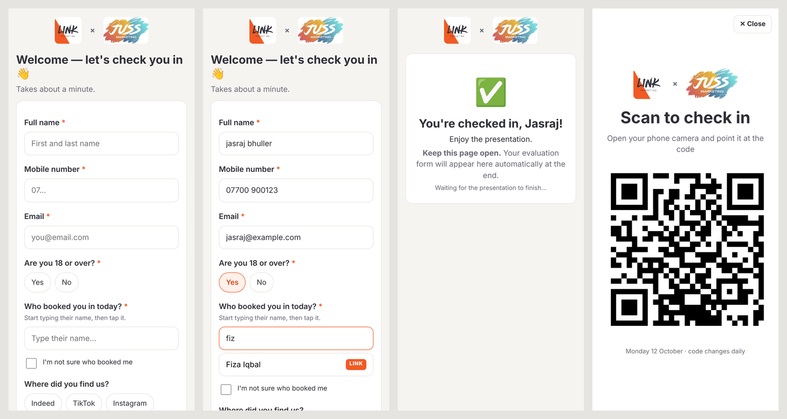
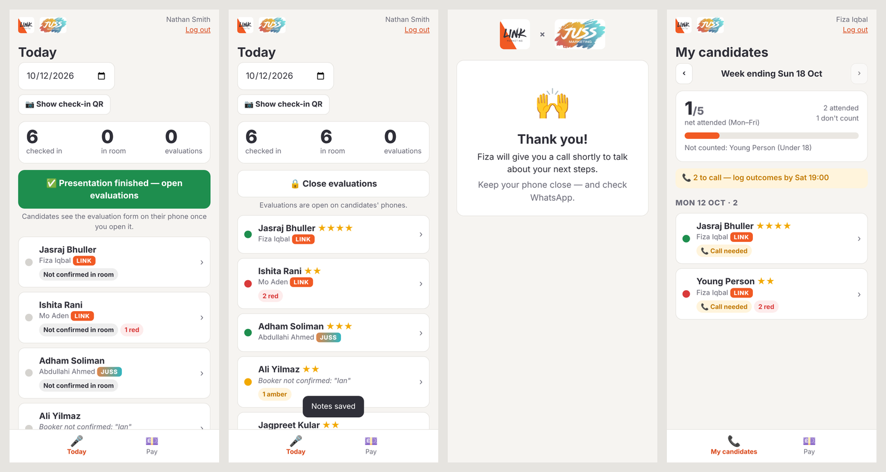

# LINK × JUSS Recruitment App

One place for the whole morning-appointment journey, replacing the handwritten sheet and the shared Google Form.

```
Candidate attends → scans daily QR → checks in (name, booker, 18+, right to work)
  → Presenter's phone: in the room ✅, Green/Amber/Red, ★1–5, tags, notes
  → Presenter opens evaluations → form appears on the candidate's phone
  → Booker emailed → one-page snapshot → call → outcome + Academy Day 1 date
  → One tap: WhatsApp welcome message (LINK or JUSS version)
  → Everything grouped by date / week ending → weekly pay report (net attended)
```

**To set it up, follow [SETUP.md](SETUP.md).** Free; runs on Google Apps Script with data in a private Google Sheet.




## Files
| File | What it is |
|---|---|
| `src/Code.gs` | Server: data, rules (flags, pay, deadlines, repeats), logins, email alerts, setup, history import |
| `src/Index.html` | Page shell |
| `src/JS.html` | The app: candidate check-in and evaluation, plus the staff app (Today, My candidates, All, Pay, Team) |
| `src/Styles.html` | Look and feel (mobile-first) |
| `src/Logos.html` | LINK and JUSS logos (embedded) |
| `src/QR.html` | QR code generator (qrcode-generator 1.4.4, MIT, embedded) |
| `src/appsscript.json` | Apps Script manifest (London time zone, web app settings) |
| `dev/` | Local test harness: a fake of Google's services plus an end-to-end browser test |

## Testing locally
```
NODE_PATH=$(npm root -g) node dev/e2e.js ./shots
```
This starts a local server that runs the real `Code.gs` against an in-memory fake of Google Sheets, Gmail and so on. It then walks the whole journey in a phone-sized browser and checks 33 rules: check-in, QR expiry, booker privacy, the LINK and JUSS messages, the late flag, pay counting, repeats, red approval, access removal and the 12-month deletion.

To click around yourself: `node dev/server.js 8787`, then open `http://localhost:8787/exec?app=staff`.
